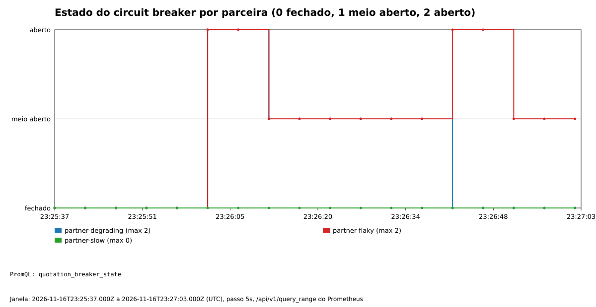
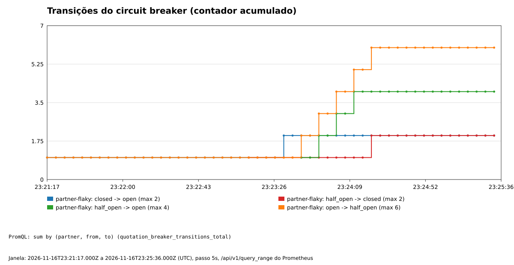
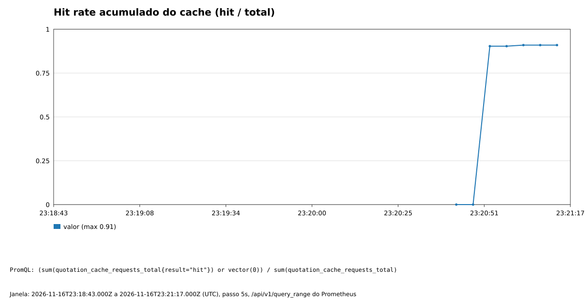
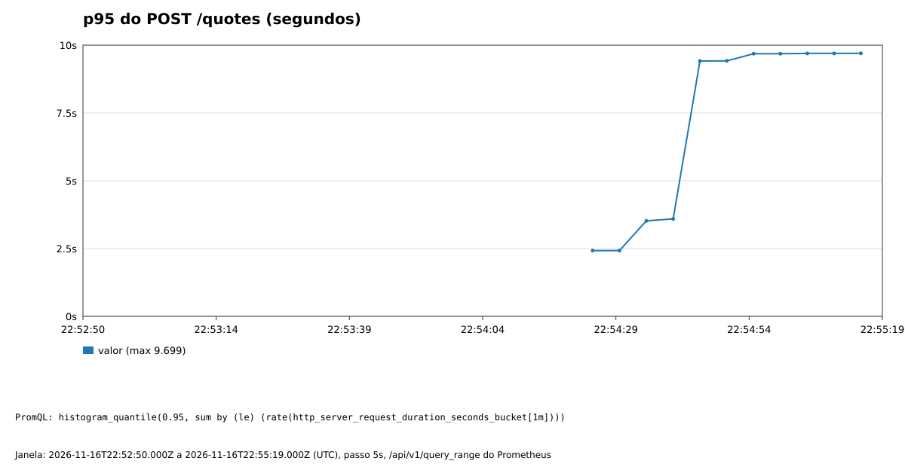
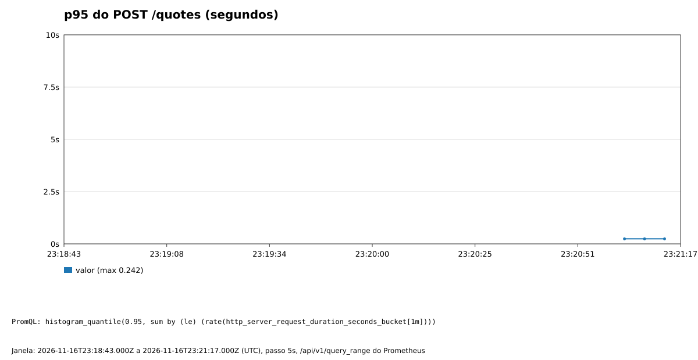

# Evidências

Tudo aqui foi medido em 16/11/2026 num runner do GitHub Actions (Linux, 4 vCPU, 15 GiB, Docker 29.4.2,
Compose v5.1.3, Go 1.25), pelo workflow [`.github/workflows/evidencias.yml`](../../.github/workflows/evidencias.yml).
A máquina de desenvolvimento não tem Docker; a limitação está declarada no [README](../../README.md).

- **Antes:** pasta [`antes/`](antes/). Código original (commit `cbc3c1e`), medido na branch `verify/antes`,
  que só acrescenta o workflow. Ambiente em [`antes/ambiente.txt`](antes/ambiente.txt).
- **Depois:** pasta [`depois/`](depois/). Código desta entrega, medido na branch `verify/depois` (commit
  `1764e80`). Ambiente em [`depois/ambiente.txt`](depois/ambiente.txt).

Os gráficos são desenhados pelo script [`.github/scripts/collect-evidence.mjs`](../../.github/scripts/collect-evidence.mjs)
a partir de `/api/v1/query_range` do Prometheus, com passo de 5 s. Cada PNG traz a consulta e a janela
escritas dentro da imagem, e o `.json` de mesmo nome ao lado guarda os pontos brutos. Os traces vêm de
`/api/traces` do Jaeger: o `.json` é o trace exportado e o `.txt` é o mesmo trace resumido, um span por linha.

## As sete evidências do enunciado

### 1. Relatório antes e depois

- **Comando:** `make down && make reproduce`, carga padrão (10 de baseline, depois 200 com 50 em voo), nas duas execuções.
- **Artefatos:** [`antes/make-reproduce.txt`](antes/make-reproduce.txt) e [`depois/make-reproduce.txt`](depois/make-reproduce.txt), saída completa. O relatório do `loadgen` está no fim de cada arquivo.
- **O que se vê:** na carga, o sucesso vai de 60% para 100%, o p95 de 8,00 s para 206 ms e a vazão de 8,1 para 719,3 req/s.

Antes:

```
baseline — 10 requests, 1 in flight, 22:54:06 UTC to 22:54:24 UTC
  success        5 of 10 (50%)
  latency        p50 1.89s   p95 2.03s   p99 2.03s   max 2.03s
  throughput     0.5 req/s in 18.74s
  failures       HTTP 502 from partner-flaky: 5

load — 200 requests, 50 in flight, 22:54:24 UTC to 22:54:49 UTC
  success        120 of 200 (60%)
  latency        p50 6.11s   p95 8.00s   p99 8.03s   max 8.05s
  throughput     8.1 req/s in 24.82s
  failures       HTTP 502 from partner-flaky: 80

baseline → load
  p95 latency    2.03s → 8.00s   3.9x
  max latency    2.03s → 8.05s   4.0x
  success        50% → 60%
  throughput     0.5 → 8.1 req/s
```

Depois:

```
baseline — 10 requests, 1 in flight, 23:20:36 UTC to 23:20:46 UTC
  success        10 of 10 (100%)
  latency        p50 197ms   p95 2.04s   p99 2.04s   max 2.04s
  throughput     1.0 req/s in 9.99s

load — 200 requests, 50 in flight, 23:20:46 UTC to 23:20:46 UTC
  success        200 of 200 (100%)
  latency        p50 13ms   p95 206ms   p99 227ms   max 242ms
  throughput     719.3 req/s in 278ms

baseline → load
  p95 latency    2.04s → 206ms   0.1x
  max latency    2.04s → 242ms   0.1x
  success        100% → 100%
  throughput     1.0 → 719.3 req/s
```

O `loadgen` conta como sucesso todo HTTP 200, e a resposta degradada é 200: os 100% dizem que nenhuma
corretora recebeu erro. O p95 do baseline não muda porque a primeira cotação de cada risco continua
consultando as três parceiras em série.

### 2. Saída do `make test`

- **Comando:** `make test`.
- **Artefatos:** [`depois/make-test.txt`](depois/make-test.txt). Para comparar, a suíte original: [`antes/make-test.txt`](antes/make-test.txt).
- **O que se vê:** os pacotes que já vinham e os novos (`internal/breaker`), todos `ok`. Quatro pacotes aparecem como `(cached)` porque o runner restaura o cache de build do Go e o código deles não mudou desde a execução anterior; a mesma suíte, sem cache e com detector de corrida (`go test -race -count=1 ./...`), está em [`depois/go-test-race.txt`](depois/go-test-race.txt).

```
go test ./...
ok  	github.com/GuilhermeOliveira591/mba_arquitetura_desafio_cotacao_seguros/cmd/loadgen	(cached)
ok  	github.com/GuilhermeOliveira591/mba_arquitetura_desafio_cotacao_seguros/cmd/partner-mock	(cached)
?   	github.com/GuilhermeOliveira591/mba_arquitetura_desafio_cotacao_seguros/cmd/quotation-api	[no test files]
ok  	github.com/GuilhermeOliveira591/mba_arquitetura_desafio_cotacao_seguros/internal/breaker	0.005s
?   	github.com/GuilhermeOliveira591/mba_arquitetura_desafio_cotacao_seguros/internal/cache	[no test files]
ok  	github.com/GuilhermeOliveira591/mba_arquitetura_desafio_cotacao_seguros/internal/partner	0.285s
ok  	github.com/GuilhermeOliveira591/mba_arquitetura_desafio_cotacao_seguros/internal/platform	(cached)
ok  	github.com/GuilhermeOliveira591/mba_arquitetura_desafio_cotacao_seguros/internal/quotation	(cached)
```

O `make smoke` também segue verde: [`depois/make-smoke.txt`](depois/make-smoke.txt).

### 3. Trace com o breaker aberto

- **Consulta:** Jaeger, `GET /api/traces?service=quotation-api`, janela da sessão inteira (de 23:18:43 a 23:27 UTC); escolhido o trace mais curto que tem um span com `quotation.breaker.short_circuited=true`.
- **Artefatos:** [`depois/trace-breaker-aberto.json`](depois/trace-breaker-aberto.json) e [`depois/trace-breaker-aberto.txt`](depois/trace-breaker-aberto.txt).
- **O que se vê:** a requisição respondeu em 0,4 ms sem nenhum span `HTTP POST`: a `partner-slow` veio do cache e as duas parceiras com circuito aberto não foram chamadas.

```
traceID 51c43ca295efa1b38a1edc3f0b1106ed | 4 spans
  +     0.0 ms       0.4 ms  POST /quotes  http.response.status_code=200 quotation.cache.hits=1 quotation.degraded=true server.address=localhost span.kind=server
  +     0.0 ms       0.2 ms  partner.quote  partner=partner-slow quotation.cache.result=hit span.kind=internal tenant_id=corretora-b
  +     0.2 ms       0.1 ms  partner.quote  partner=partner-flaky quotation.breaker.short_circuited=true quotation.cache.result=miss span.kind=internal tenant_id=corretora-b event=partner call short-circuited: circuit open
  +     0.3 ms       0.1 ms  partner.quote  partner=partner-degrading quotation.breaker.short_circuited=true quotation.cache.result=miss span.kind=internal tenant_id=corretora-b event=partner call short-circuited: circuit open
```

Para comparar com o antes, em que o span de saída existe e dura 6,1 s: [`antes/trace-antes-lento.txt`](antes/trace-antes-lento.txt).

### 4. Trace servido de cache

- **Consulta:** a mesma do item 3; escolhido um trace em que os três spans `partner.quote` têm `quotation.cache.result=hit` e não há span cliente.
- **Artefatos:** [`depois/trace-servido-de-cache.json`](depois/trace-servido-de-cache.json) e [`depois/trace-servido-de-cache.txt`](depois/trace-servido-de-cache.txt).
- **O que se vê:** a cotação completa saiu em 1,6 ms com três acertos de cache e nenhum span de saída para as parceiras.

```
traceID c4742728478b532fe4698f5da9738a2d | 4 spans
  +     0.0 ms       1.6 ms  POST /quotes  http.response.status_code=200 quotation.cache.hits=3 quotation.degraded=false server.address=quotation-api span.kind=server
  +     0.0 ms       0.7 ms  partner.quote  partner=partner-slow quotation.cache.result=hit span.kind=internal tenant_id=corretora-a
  +     0.7 ms       0.2 ms  partner.quote  partner=partner-flaky quotation.cache.result=hit span.kind=internal tenant_id=corretora-a
  +     0.9 ms       0.6 ms  partner.quote  partner=partner-degrading quotation.cache.result=hit span.kind=internal tenant_id=corretora-a
```

### 5. Estado do breaker no tempo

Dois gráficos de estado, mais o contador de transições de cada um.

**Variações 2 e 3 (o degrau completo).**

- **Consulta:** `quotation_breaker_state`
- **Janela:** de 23:25:37 a 23:27:03 UTC, passo de 5 s.
- **Artefato:** [`depois/variacao-2-e-3/breaker-estado.png`](depois/variacao-2-e-3/breaker-estado.png) (pontos em [`breaker-estado.json`](depois/variacao-2-e-3/breaker-estado.json)).
- **O que se vê:** a `partner-degrading` vai de fechado para aberto às 23:26:02, meio aberto às 23:26:12 e fechado às 23:26:42; a `partner-flaky` faz o mesmo caminho até o meio aberto e reabre, porque a sonda dela falhou.



Até 23:26:42 a linha da `partner-degrading` está por baixo da linha da `partner-flaky`: as duas abriram e
passaram a meio aberto no mesmo instante. O log da API confirma a ordem
([`depois/log-quotation-api.txt`](depois/log-quotation-api.txt)):

```
2026/11/16 23:25:53 quotation-api: breaker of partner-flaky went from closed to open
2026/11/16 23:25:53 quotation-api: breaker of partner-degrading went from closed to open
2026/11/16 23:26:04 quotation-api: breaker of partner-flaky went from open to half_open
2026/11/16 23:26:04 quotation-api: breaker of partner-degrading went from open to half_open
2026/11/16 23:26:33 quotation-api: breaker of partner-flaky went from half_open to open
2026/11/16 23:26:33 quotation-api: breaker of partner-degrading went from half_open to closed
2026/11/16 23:26:44 quotation-api: breaker of partner-flaky went from open to half_open
```

O contador de transições da mesma janela:

- **Consulta:** `sum by (partner, from, to) (quotation_breaker_transitions_total)`
- **Artefato:** [`depois/variacao-2-e-3/breaker-transicoes.png`](depois/variacao-2-e-3/breaker-transicoes.png).
- **O que se vê:** uma transição `closed -> open`, uma `open -> half_open` e uma `half_open -> closed` para a `partner-degrading`. Os pontos isolados no início da janela (valores 2, 4 e 6) são séries da instância anterior da API, que o `make load` recriou.

**Variação 1 (a `partner-flaky` em série, onde a sequência de falhas é determinística).**

- **Consulta:** `sum by (partner, from, to) (quotation_breaker_transitions_total)`
- **Janela:** de 23:21:17 a 23:25:36 UTC, passo de 5 s.
- **Artefato:** [`depois/variacao-1/breaker-transicoes.png`](depois/variacao-1/breaker-transicoes.png).
- **O que se vê:** a segunda abertura às 23:23:32, quatro sondas seguidas que reabrem o circuito (a rajada das sequências 54 a 57) e a que fecha, às 23:24:22. No fim são 2 `closed -> open`, 6 `open -> half_open`, 4 `half_open -> open` e 2 `half_open -> closed`, a mesma lista do teste `TestBreakerOpensOnTheFlakyBurstAndStopsCallingThePartner`.



O estado da mesma janela está em [`depois/variacao-1/breaker-estado.png`](depois/variacao-1/breaker-estado.png)
(consulta `quotation_breaker_state`): ali o meio aberto não aparece, porque com tráfego contínuo a sonda
sai em menos de 2 s e a métrica é exportada a cada 10 s. Os pontos em 23:21:17 nos dois gráficos são da
instância anterior da API, a da carga padrão.

### 6. Hit rate do cache

- **Consulta:** `(sum(quotation_cache_requests_total{result="hit"}) or vector(0)) / sum(quotation_cache_requests_total)`
- **Janela:** de 23:18:43 a 23:21:17 UTC (a carga padrão), passo de 5 s.
- **Artefato:** [`depois/cache-hit-rate.png`](depois/cache-hit-rate.png) (pontos em [`cache-hit-rate.json`](depois/cache-hit-rate.json)).
- **O que se vê:** o acerto acumulado sai de 0 às 23:20:43, quando só as cinco primeiras cotações tinham passado, e chega a 0,91 às 23:21:03.



A curva tem poucos pontos porque a carga padrão inteira dura 10 s e a métrica é exportada a cada 10 s. O
valor é propriedade da carga (5 cotações repetidas em 210 requisições), não da produção: o hit rate da
seção 8 do SAD sai do pressuposto P1.

### 7. p95 do `POST /quotes`

- **Consulta:** `histogram_quantile(0.95, sum by (le) (rate(http_server_request_duration_seconds_bucket[1m])))`
- **Janela, antes:** de 22:52:50 a 22:55:19 UTC. **Janela, depois:** de 23:18:43 a 23:21:17 UTC. Passo de 5 s, mesma escala nos dois (0 a 10 s).
- **Artefatos:** [`antes/p95-post-quotes.png`](antes/p95-post-quotes.png) e [`depois/p95-post-quotes.png`](depois/p95-post-quotes.png).
- **O que se vê:** antes, o p95 sobe até 9,7 s durante a carga; depois, fica em 0,24 s.

Antes:



Depois:



O valor do gráfico não é o do relatório (9,7 s contra 8,00 s; 0,24 s contra 206 ms): o histograma tem
baldes largos e interpola dentro deles. A comparação numérica é a do relatório de texto do item 1.

## Evidências além das sete

| Artefato | Comando ou consulta | O que se vê |
|---|---|---|
| [`depois/variacao-1-cache-frio-em-serie.txt`](depois/variacao-1-cache-frio-em-serie.txt) | `make load ARGS="-baseline 0 -requests 120 -concurrency 1 -distinct 120 -duration 10m"` | 120 cotações diferentes em série: 100% de sucesso, p95 de 2,04 s |
| [`depois/variacao-2-cache-frio-50-em-voo.txt`](depois/variacao-2-cache-frio-50-em-voo.txt) | `make load ARGS="-tenant corretora-b -baseline 0 -requests 200 -concurrency 50 -distinct 200 -duration 10m"` | o pior caso, cache vazio com 50 em voo: 100% de sucesso, p95 de 3,87 s contra 8,00 s do antes |
| [`depois/variacao-3-cache-morno-50-em-voo.txt`](depois/variacao-3-cache-morno-50-em-voo.txt) | `go run ./cmd/loadgen -tenant corretora-b -baseline 0 -requests 200 -concurrency 50 -distinct 200 -duration 10m` | a mesma carga logo em seguida: p95 de 21 ms |
| [`depois/variacao-2-e-3/latencia-por-parceira.png`](depois/variacao-2-e-3/latencia-por-parceira.png) | `histogram_quantile(0.95, sum by (partner, le) (rate(quotation_partner_duration_seconds_bucket[1m])))`, de 23:25:37 a 23:27:03 UTC | a `partner-degrading` sai de 0,19 s e bate no teto do timeout (balde de 2,0 a 2,5 s) |
| [`depois/variacao-2-e-3/p95-post-quotes.png`](depois/variacao-2-e-3/p95-post-quotes.png) | a consulta do item 7, de 23:25:37 a 23:27:03 UTC | o p95 da API no pior caso, no balde de 2,5 a 5 s |
| [`depois/resposta-degradada.json`](depois/resposta-degradada.json) | `curl` de um risco novo para `corretora-b`, com os circuitos abertos (dados fictícios) | o contrato degradado: uma proposta, `degraded: true` e duas parceiras em `unavailable` com `circuit_open` |
| [`depois/resposta-apos-sonda.json`](depois/resposta-apos-sonda.json) | o mesmo `curl`, com outra placa, 30 s depois | a sonda da `partner-degrading` passou e ela voltou à resposta; a `partner-flaky` falhou na sonda e aparece com `error` |
| [`depois/atributos-de-span.txt`](depois/atributos-de-span.txt) | todas as chaves de atributo dos traces de `POST /quotes` da sessão | nenhuma chave com documento, CPF, placa ou `quote_id` |
| [`depois/metricas-no-prometheus.txt`](depois/metricas-no-prometheus.txt) | `GET /api/v1/label/__name__/values` e `/api/v1/series` | as métricas `quotation_*` existem no Prometheus, com os rótulos de cada uma |
| [`antes/trace-antes-lento.txt`](antes/trace-antes-lento.txt), [`antes/trace-antes-erro.txt`](antes/trace-antes-erro.txt) | Jaeger, trace mais longo e trace com 502 do antes | a cascata em série (8,05 s) e o trace em que a terceira parceira nem é chamada |
| [`antes/p95-por-parceira-http.png`](antes/p95-por-parceira-http.png) | `histogram_quantile(0.95, sum by (server_address, le) (rate(http_client_request_duration_seconds_bucket[1m])))`, de 22:52:50 a 22:55:19 UTC | no antes, a `partner-degrading` chega a 7,3 s de p95 pela borda HTTP |

As variações 1 e 2 rodam pelo `make load`, que recria os contêineres da API e das parceiras a cada
execução (comportamento do `docker compose run --build` do `Makefile` original). Por isso cada uma começa
com os breakers fechados e os contadores zerados, e a sequência da `partner-flaky` recomeça do 1. O Redis
não é recriado, e é por isso que a variação 2 usa outra corretora: a chave de cache tem a corretora, então
para a `corretora-b` os mesmos riscos são todos `miss`. A variação 3 roda do host, com `go run`, para
continuar na mesma instância da API.
