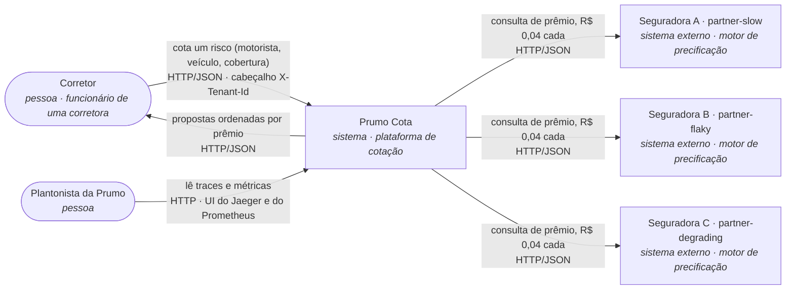
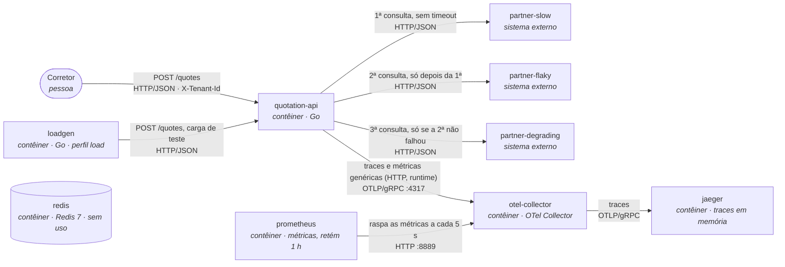
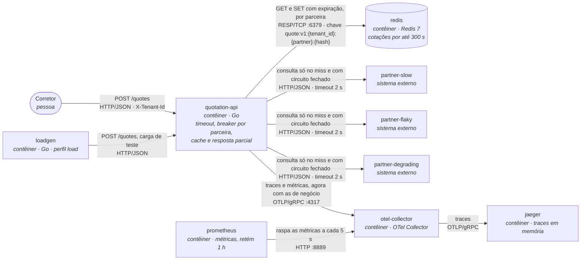
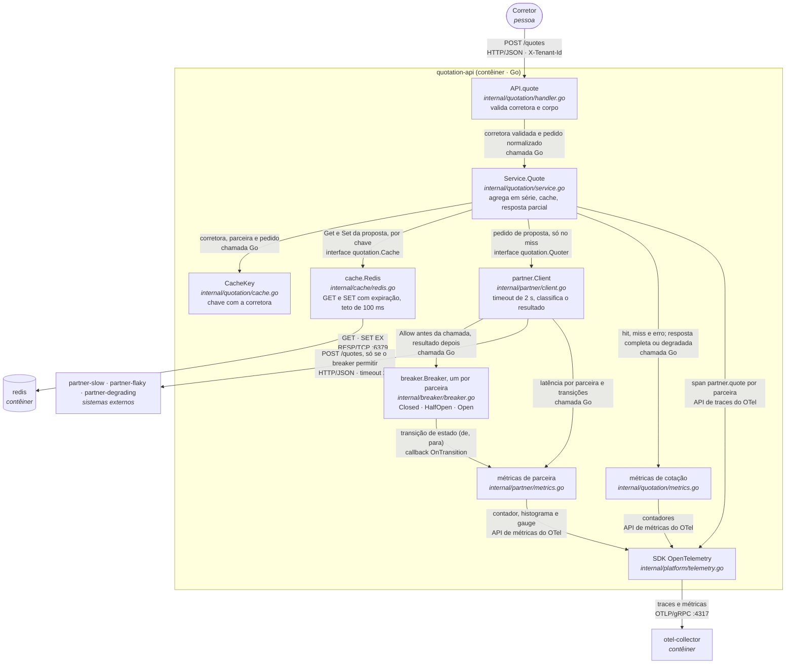

# SAD — Prumo Cota: a fronteira com as seguradoras

Solution Architecture Document da plataforma de cotação de seguro auto da Prumo depois da intervenção
descrita aqui. Versão de 16/11/2026. O enunciado que este documento responde está em
[`docs/enunciado.md`](enunciado.md).

Convenção usada no documento inteiro:

- **[implementado]** existe no repositório e o caminho citado pode ser aberto;
- **[proposta]** é decisão de arquitetura que este documento defende e que **não** está no código;
- **[medido]** é número que saiu de uma execução minha, com o arquivo de evidência ao lado;
- **[pressuposto]** é número que eu assumi, declarado na seção 1.4.

Todas as medições vieram de um runner do GitHub Actions (Linux, 4 vCPU, 15 GiB), porque a máquina de
desenvolvimento não tem Docker. O workflow é [`.github/workflows/evidencias.yml`](../.github/workflows/evidencias.yml)
e a limitação está declarada no [README](../README.md).

## 1. Introdução

### 1.1 Propósito e leitores

Este documento sustenta uma decisão: **gastar cerca de R$ 47 mil uma vez e R$ 4,9 mil por mês para
proteger a fronteira da plataforma com as três seguradoras, usando timeout, circuit breaker, cache e
resposta parcial**. Ele serve a três leitores:

- o **CTO**, que aprova o gasto: a conta está na seção 8 e o veredito é que ele se paga em menos de um mês;
- quem **opera** a plataforma: os três alertas e o runbook estão na seção 6, os desastres na seção 7;
- o **encarregado de dados e auditoria**: a chave de cache, o que fica guardado e por quanto tempo estão
  na seção 4.2; a rastreabilidade da cotação servida de cache está na 4.3; o acervo de auditoria, na 5.3 e na 8.2.

### 1.2 Escopo

Dentro: a `quotation-api` e a sua fronteira com as seguradoras, isto é, os pacotes `internal/quotation`,
`internal/partner`, `internal/breaker`, `internal/cache` e `internal/platform`, o `docker-compose.yml` e a
telemetria de negócio que prova o comportamento.

Fora: o motor de precificação das seguradoras (os mocks em `cmd/partner-mock/` são restrição do cenário e
não foram alterados), o gerador de carga (`cmd/loadgen/`), o CRM e a tela do corretor, cadastro de
corretoras, cobrança e autenticação.

### 1.3 Restrições e decisões

O que me foi imposto e o que eu escolhi não são a mesma coisa, e o documento só defende o segundo grupo.

| Restrição (imposta pelo enunciado) | Decisão (minha, defendida neste documento) |
|---|---|
| Go 1.25, Docker Compose, Redis como cache, OpenTelemetry | Biblioteca de circuit breaker: nenhuma, implementação própria (4.1) |
| Três parceiras, com os perfis do `docker-compose.yml` | Timeout de 2 000 ms por parceira (4.1) |
| Cobrança de R$ 0,04 por consulta | Breaker por parceira, abre com 5 falhas consecutivas, fica aberto 10 s, 1 sonda (4.1) |
| Prêmio é sempre da parceira; teto de 24 h para reaproveitar | Cache por parceira, TTL de 300 s, chave com a corretora (4.2) |
| Auditoria por 5 anos, não regravável (SUSEP) | Fallback: resposta parcial marcada como degradada (4.3) |
| Prumo é operadora; uso cruzado de dados proibido (LGPD) | Hospedagem: nuvem pública em região no Brasil (5.3) |
| Os testes que vieram continuam verdes | Comportamento novo ligado por opção no boot, o construtor antigo fica como era (5.1) |

### 1.4 Pressupostos

Cada um tem valor, origem e o que muda se for falso. São os números que eu **não** medi.

| ID | Pressuposto | Valor | Origem | Se for falso |
|---|---|---|---|---|
| P1 | Fração das cotações que repetem, em até 300 s, uma cotação da **mesma corretora** para o mesmo risco e a mesma cobertura | 45% esperado, 25% pessimista | O enunciado diz que o corretor recota a mesma placa várias vezes na mesma conversa; o valor é meu. A repetição entre corretoras diferentes não conta, porque a chave isola a corretora | É o hit rate da seção 8. Com 25% a economia cai de R$ 142.560 para R$ 79.200 por mês. Abaixo de 3% o cache não paga a construção em 12 meses e o veredito da seção 8 se inverte |
| P2 | Outros 15% das cotações repetem entre 300 s e 24 h | 15% | Meu, pela mesma frase do enunciado (o cliente que volta no mesmo dia) | É o que um TTL de 24 h acrescentaria (linha de referência da seção 8). Se for 40%, parar em 300 s deixa R$ 126.720 por mês na mesa e a decisão de TTL da 4.2 precisa ser reaberta |
| P3 | A demanda de 120.000 cotações por dia útil se concentra em 8 h, com pico de 3 vezes a média | média de 4,2 req/s, pico de 12,5 req/s | 120.000 é do enunciado; as 8 h e o fator 3 são meus | Dimensiona a simultaneidade na `partner-degrading` (seções 4.4 e 7). Com pico acima de 36 req/s de cotações sem cache ela passa de 5 chamadas simultâneas e começa a afundar em operação normal, não só em desastre |
| P4 | Um registro de auditoria ocupa 1,2 kB e o armazenamento de objetos custa R$ 0,13 por GB por mês, por cópia | 1,2 kB; R$ 0,13 | Tamanho: soma dos campos do contrato `Response` em `internal/quotation/request.go`. Preço: referência minha, a validar em cotação com o provedor | Entra só na seção 8.2. Com registro de 5 kB o acervo do ano 5 vai de 190 GB para 792 GB e o custo anual de R$ 539 para R$ 2.245, ainda irrelevante diante do pessoal |
| P5 | Custo mensal carregado por pessoa: desenvolvimento R$ 18.000, arquitetura R$ 25.000, operação R$ 20.000 | ver valor | Meu | Escala linearmente o custo de construção da seção 8.3. Dobrando, o payback vai de 8 para 15 dias úteis |

## 2. Visão geral da arquitetura

### 2.1 Contexto (C4 nível 1)

A Prumo intermedeia: não precifica, não emite apólice e não assume risco. Todo prêmio que a corretora vê
foi produzido por uma seguradora.



### 2.2 Contêineres antes (C4 nível 2)

É o `docker-compose.yml` como veio. O Redis sobe e ninguém fala com ele; a API consulta as três
parceiras em série, sem limite de espera.



### 2.3 Contêineres depois (C4 nível 2)

Nenhum contêiner novo. O que muda são duas relações e o conteúdo de uma terceira.



### 2.4 Delta

Acrescenta:

- a relação `quotation-api` → `redis`, que não existia;
- timeout e um circuit breaker por parceira em cada chamada de saída;
- resposta parcial: o contrato de `POST /quotes` ganha `degraded`, `unavailable` e, em cada proposta,
  `source`, `fetched_at` e `age_seconds`;
- cinco séries de negócio na telemetria e um span por parceira (seção 5.2).

Muda de lugar:

- a falha de uma parceira deixa de derrubar a requisição e passa a ser um item de `unavailable`;
- o custo da repetição sai da fatura das seguradoras e vira memória no Redis.

Sai: nada. A agregação continua em série (4.5).

A quem esta arquitetura serve: à corretora, que deixa de receber 502 quando uma seguradora falha; ao
financeiro da Prumo, que deixa de comprar a mesma consulta duas vezes em cinco minutos; e ao plantonista,
que passa a ter três sinais com limiar em vez de um 502 genérico.

## 3. Requisitos

### 3.1 Funcionais

| ID | Requisito (frase testável) | Origem | Estado |
|---|---|---|---|
| RF-01 | `POST /quotes` sem `X-Tenant-Id` devolve 400; com corretora fora de `TENANTS` devolve 403; em nenhum dos dois casos uma parceira é chamada | contrato existente, `internal/quotation/handler.go` | [implementado], já vinha |
| RF-02 | A resposta traz as propostas em ordem crescente de `premium_cents`, inclusive quando é degradada | contrato existente, `internal/quotation/service.go` | [implementado] |
| RF-03 | Todo `premium_cents` apresentado foi devolvido por uma parceira, agora ou em consulta anterior da mesma corretora para o mesmo risco; a plataforma nunca calcula prêmio | enunciado | [implementado] |
| RF-04 | Com uma ou duas parceiras indisponíveis (erro, timeout ou circuito aberto), `POST /quotes` devolve 200 com `degraded: true` e `unavailable` listando cada parceira ausente e o motivo; com as três indisponíveis devolve 502 `partner insurer unavailable` | **criado por esta arquitetura** (4.3) | [implementado] |
| RF-05 | Uma cotação repetida pela mesma corretora, para o mesmo risco e a mesma cobertura, em até 300 s, é respondida sem chamar a parceira, com `source: "cache"`, o mesmo `quote_id` e o `fetched_at` da consulta original; a mesma cotação pedida por outra corretora chama a parceira | **criado por esta arquitetura** (4.2) | [implementado] |
| RF-06 | Com o circuito de uma parceira aberto, nenhuma requisição HTTP sai para ela; a consulta não é comprada | **criado por esta arquitetura** (4.1) | [implementado] |
| RF-07 | Toda cotação apresentada, inclusive de cache e degradada, fica registrada por 5 anos, sem regravação, com seguradora, prêmio, corretora e instante | enunciado (SUSEP) | [proposta], seção 5.3; a resposta já carrega os campos que o registro precisa |

### 3.2 Não funcionais

O "hoje" das linhas marcadas com [medido] saiu de `make down && make reproduce` sobre o código original
(commit `cbc3c1e`), em 16/11/2026. O relatório completo está em
[`docs/evidencias/antes/make-reproduce.txt`](evidencias/antes/make-reproduce.txt).

| ID | Requisito | Métrica | Hoje | Alvo | Como medir | Por que este número |
|---|---|---|---|---|---|---|
| RNF-01 | Latência da cotação sob carga | p95 do `POST /quotes`, 50 em voo | 8,00 s [medido] | ≤ 4,0 s com o cache vazio | relatório do `loadgen` e `http_server_request_duration_seconds` no Prometheus | É o teto que a arquitetura impõe com agregação em série: 1,7 s da `partner-slow` saudável, mais 0,2 s da `partner-flaky`, mais os 2,0 s do timeout na `partner-degrading`, 3,9 s, mais 0,1 s de margem. Com cache, a cotação repetida não espera parceira nenhuma |
| RNF-02 | Disponibilidade da cotação | % de `POST /quotes` com 200, carga padrão | 60% na carga, 50% no baseline [medido] | ≥ 99% | linha `success` do relatório do `loadgen`; em produção, `quotation_responses_total` por `outcome` | A `partner-slow` nunca falha, então sempre existe ao menos uma proposta verdadeira para apresentar. O 1% é margem para falha da própria plataforma |
| RNF-03 | Espera máxima por uma parceira | maior tempo de uma chamada de saída | 6,15 s [medido] (span da `partner-degrading` em [`trace-antes-lento.txt`](evidencias/antes/trace-antes-lento.txt)) | ≤ 2,0 s | `quotation_partner_duration_seconds` por `partner` | 2,0 s é o timeout (4.1): cobre a `partner-slow` saudável, que levou até 1,70 s no mesmo trace, com 0,3 s de folga |
| RNF-04 | Consultas compradas por cotação | consultas às parceiras ÷ cotações | 3,0 (enunciado; hoje não há cache) | ≤ 1,65 em produção | 3 × (1 − hit rate), com o hit rate de `quotation_cache_requests_total` | 1,65 = 3 × (1 − 0,45), o hit rate esperado de P1. É a linha que paga a conta da seção 8 |
| RNF-05 | Chamadas a uma parceira em falha contínua | chamadas que saem antes de o circuito abrir, e depois | todas saem, sem limite (código original) | 5 antes de abrir; depois, 1 a cada 10 s | `quotation_breaker_transitions_total` e o teste `TestBreakerOpensOnTheFlakyBurstAndStopsCallingThePartner` | 5 e 10 s são os parâmetros do breaker (4.1) |
| RNF-06 | Permanência de dado de cotação no cache | idade máxima de uma entrada | não se aplica (sem cache) | ≤ 300 s | `redis-cli TTL <chave>` e o teste `TestCacheEntryExpiresWithTheTTL` | 300 s é o TTL (4.2) e a validade que a própria parceira declara em `valid_for_seconds` |

O resultado medido depois da intervenção está na seção 5.4.

## 4. Detalhamento da arquitetura

### 4.1 Decisão 1: timeout e circuit breaker

**Contexto.** `internal/partner/client.go` chamava a parceira com `Timeout` zero e sem proteção. No trace
mais longo do "antes" a `partner-degrading` segurou a requisição por 6,15 s. Ela não falha, afunda: soma
300 ms por chamada simultânea acima de cinco. Um contador de falhas sozinho nunca a enxerga.

**Opções consideradas.**

1. *Biblioteca `github.com/sony/gobreaker/v2`.* Tem os três estados e é a mais usada. Descartada: na
   versão 2.4.0, que eu abri, o arquivo `gobreaker.go` chama `time.Now()` direto, sem relógio injetável.
   A passagem de aberto para meio aberto só poderia ser testada com `sleep`, que o enunciado proíbe.
2. *Implementação própria, com relógio injetável.* Cerca de 150 linhas.
3. *Política por taxa de falha em janela* (por exemplo, 50% em 10 chamadas), em qualquer das duas. Descartada
   pelo perfil da `partner-flaky`: com 40% de falha aleatória, uma janela de 10 chamadas tem 5 ou mais
   falhas em 37% das vezes. O `make smoke` mostra o efeito: essa política abre 15 vezes em 210
   requisições, contra 7 da política de 5 consecutivas
   ([`make-smoke.txt`](evidencias/antes/make-smoke.txt)). Abrir o circuito de uma parceira que responde
   60% das vezes joga fora propostas boas.
4. *Escopo do breaker:* um global, um por parceira, ou um por par (parceira, corretora).

**Escolha.** Implementação própria em `internal/breaker/breaker.go` [implementado], com os estados
`Closed`, `HalfOpen` e `Open` nomeados no código, **um breaker por parceira**, criado em
`internal/partner/client.go`. Um breaker global derrubaria as três seguradoras porque uma afundou. Um
por (parceira, corretora) multiplicaria por algumas centenas o número de falhas necessário para a
plataforma inteira aprender que a seguradora caiu, e a saúde da seguradora não depende de quem pergunta.

| Parâmetro | Valor | Onde | Por que este valor |
|---|---|---|---|
| Timeout por chamada | 2 000 ms | `PARTNER_TIMEOUT_MS` | A `partner-slow` saudável responde em 1 500 ± 200 ms; o máximo, 1 700 ms, apareceu no meu trace (1 699,8 ms). 2 000 ms dá 300 ms de folga sem cortar a parceira lenta que funciona. A `partner-degrading` cruza 2 000 ms com 12 chamadas simultâneas (160 + 300 × 7 = 2 260 ms), então o timeout é o que transforma o afundamento dela em sinal |
| Falhas que abrem | 5 consecutivas | `BREAKER_FAILURE_THRESHOLD` | Com 40% de falha aleatória, cinco seguidas por acaso têm probabilidade de 0,4⁵ = 1%. O ruído da `partner-flaky` quase nunca abre; a rajada das sequências 49 a 57 abre na quinta falha |
| Janela | não é de tempo: é a sequência desde o último sucesso | `internal/breaker/breaker.go` | Um sucesso zera a contagem. Não depende do volume de tráfego e é determinístico em teste |
| Tempo aberto | 10 s | `BREAKER_OPEN_SECONDS` | Na média de 4,2 req/s (P3) são cerca de 42 cotações sem essa parceira por abertura. Menos que isso multiplica as sondas numa parceira doente; mais que isso não ajuda a `partner-degrading`, que se recupera assim que a simultaneidade cai. E 10 s é o intervalo de exportação de métricas (`metricInterval` em `internal/platform/telemetry.go`), então toda abertura aparece no gráfico de estado |
| Requisições em meio aberto | 1 de cada vez | constante `HalfOpenProbes` | A `partner-degrading` afunda acima de 5 simultâneas; testá-la com uma rajada a derrubaria de novo |
| O que fecha | 1 sonda com sucesso | `internal/breaker/breaker.go` | |
| O que reabre | 1 sonda com falha, por mais 10 s | `internal/breaker/breaker.go` | |

O estouro do timeout **conta como falha** para o breaker. Também contam erro de transporte, HTTP 5xx e
corpo ilegível. Não contam HTTP 4xx (o problema é do pedido, não da seguradora) nem o cancelamento por
quem chamou (o corretor que fecha a tela não pode abrir o circuito de uma seguradora).

Aberto quer dizer que a chamada não sai: `Client.Quote` consulta `Breaker.Allow()` antes de montar a
requisição HTTP e, se a resposta for não, devolve um erro com `ShortCircuited` sem tocar na rede.

**Consequências.**

- Boas: a espera por parceira tem teto de 2 s; uma seguradora em falha contínua recebe 5 chamadas e depois
  1 a cada 10 s; os três estados são testados sem `sleep`.
- Ruins: código de resiliência próprio é código que a Prumo mantém, sem a comunidade de uma biblioteca.
  Uma parceira com 40% a 50% de falha **estável** nunca abre o circuito: quem a pega é o alerta A3 da
  seção 6, não o breaker. Passados os 10 s o circuito fica meio aberto e
  assim permanece até uma requisição sair como sonda: uma parceira sem tráfego aparece "meio aberta" no
  gráfico até alguém pedir.
- Os limites que esta decisão não resolve estão na seção 4.4 (limites 1, 2 e 4).

### 4.2 Decisão 2: cache

**Contexto.** São 7.920.000 consultas por mês a R$ 0,04, R$ 316.800, 48% da receita. O Redis já sobe no
compose. A cotação carrega CPF e placa, e cada corretora tem condição comercial própria: a mesma placa
tem prêmios diferentes conforme quem pergunta.

**Opções consideradas.**

1. *Cache da resposta agregada*, uma entrada por (corretora, risco). Economiza uma ida ao Redis, mas vence
   inteira de uma vez e não guarda nada quando uma das três falha, que é o caso comum com a `partner-flaky`.
2. *Cache por parceira*, uma entrada por (corretora, parceira, risco).
3. *Cache em memória do processo.* Descartado: não é compartilhado entre réplicas, some a cada deploy, e
   o enunciado fixa Redis.
4. *TTL:* 300 s, 1 h ou as 24 h do teto comercial.

**Escolha.** Cache **por parceira** no Redis, com **TTL de 300 s** [implementado] em
`internal/quotation/service.go`, `internal/quotation/cache.go` e `internal/cache/redis.go`.

A chave, por extenso:

```
quote:v1:{tenant_id}:{partner}:{sha256(JSON do pedido normalizado), em hexadecimal}
```

- `quote:v1` é o namespace e a versão do formato. Trocar para `v2` invalida tudo de uma vez.
- `{tenant_id}` é o valor do cabeçalho `X-Tenant-Id`, em texto claro e escapado. **É o contrato de
  isolamento**: a mesma placa cotada por duas corretoras produz duas chaves. Fica em claro para que as
  entradas de uma corretora possam ser listadas e apagadas pelo prefixo `quote:v1:{tenant_id}:`.
- `{partner}` é o nome da parceira (`partner-slow`, `partner-flaky`, `partner-degrading`).
- o hash cobre todos os campos que mudam o prêmio, depois de `Request.Normalize()`: `driver.document`,
  `driver.birth_year`, `vehicle.plate`, `vehicle.model`, `vehicle.year`, `vehicle.value_cents` e
  `coverage`. Vai em hash para que CPF e placa não fiquem legíveis em nome de chave.

Exemplo real de formato: `quote:v1:corretora-a:partner-slow:` seguido de 64 caracteres hexadecimais. O
valor guardado é a proposta da parceira e o instante da consulta (`fetched_at`); não contém CPF nem placa.

Por que 300 s e não as 24 h do teto:

- a própria parceira declara `valid_for_seconds: 300` em cada resposta. Servir a proposta depois disso é
  apresentar um prêmio que a seguradora já disse que não vale. O código aplica
  `min(CACHE_TTL_SECONDS, valid_for_seconds)`, então o cache nunca ultrapassa a validade declarada;
- a repetição que P1 descreve é a da conversa do corretor com o cliente, que cabe em cinco minutos;
- o dado derivado de CPF e placa fica no máximo 300 s no Redis, o que é minimização da LGPD em vez de prazo de descarte a administrar.

O custo de parar antes do teto são os 15 pontos de hit rate de P2, R$ 47.520 por mês (seção 8.1).

A política além do TTL:

| Pergunta | Resposta |
|---|---|
| O que acontece com a entrada quando o breaker abre? | Nada. O cache é consultado **antes** do breaker: se há entrada viva, ela é servida e o breaker nem é perguntado. Se não há, a parceira entra em `unavailable` |
| A cotação vencida ainda é servida? | Nunca. Passados os 300 s o Redis apagou a entrada. Não existe "servir vencido enquanto a parceira está fora" |
| A corretora fica sabendo que veio de cache? | Sim: `source: "cache"`, `fetched_at` e `age_seconds` em cada proposta |
| O que invalida uma entrada antes da hora? | Nada automático. É o limite 3 da seção 4.4 |
| Como as entradas somem? | Todo `SET` vai com expiração; o Redis descarta sozinho. Para apagar as de uma corretora antes disso (fim de contrato, pedido do controlador): `redis-cli --scan --pattern 'quote:v1:{tenant_id}:*'` e `DEL` |
| E se o Redis falhar? | A consulta ao cache vira `miss` (contada como `result="error"`), a parceira é chamada e a cotação sai. Cada comando tem teto de 100 ms (`CACHE_TIMEOUT_MS`) |

**Consequências.**

- Boas: a repetição não é comprada; uma parceira fora não invalida o que as outras duas já tinham; a
  corretora A nunca recebe o que a B cotou, o que está preso pelo teste `TestCacheNeverCrossesBrokers`.
- Ruins: três idas ao Redis por cotação, em série. Duas requisições simultâneas da mesma corretora para o
  mesmo risco, uma servida de cache e outra chegando no instante em que a entrada vence, podem devolver
  dois prêmios diferentes no mesmo minuto; não há deduplicação de consultas em voo, e o enunciado deixa
  isso fora do código. O hash é SHA-256 sem segredo: é pseudonimização, não anonimização, porque o espaço
  de CPFs é pequeno o bastante para força bruta por quem tiver acesso ao Redis. **[proposta]**: trocar por
  HMAC com segredo guardado fora do Redis. Maiúsculas e minúsculas em `vehicle.model` geram chaves
  diferentes, o que erra para o lado seguro (um miss a mais, nunca um hit errado).

### 4.3 Decisão 3: fallback

**Contexto.** No código original uma parceira falhando abortava a requisição e jogava fora as respostas
que já tinham chegado: 80 de 200 requisições viraram 502 na minha medição, todas por causa da
`partner-flaky`, depois de esperar 1,5 s pela `partner-slow`.

**Opções consideradas.**

1. *Resposta parcial:* entregar as propostas que chegaram e nomear a parceira que faltou.
2. *Cotação anterior do cache, vencida, marcada como tal.* Descartada: depois dos 300 s a seguradora não
   declara mais aquele prêmio como válido. Dentro dos 300 s isso já é o cache da decisão 2, não fallback.
3. *Recusa explícita* com erro de negócio. Descartada: a corretora perderia duas propostas verdadeiras
   por causa de uma ausente.

**Escolha.** **Resposta parcial** [implementado] em `internal/quotation/service.go`, refletida no contrato
`Response` de `internal/quotation/request.go`:

```json
{
  "tenant_id": "corretora-a",
  "quotes": [
    {
      "partner": "partner-degrading",
      "quote_id": "partner-degrading-3f2a1c0b9d8e7f60",
      "premium_cents": 84210,
      "currency": "BRL",
      "coverage_cents": 5000000,
      "valid_for_seconds": 300,
      "source": "cache",
      "fetched_at": "2026-11-16T23:10:02Z",
      "age_seconds": 42
    }
  ],
  "degraded": true,
  "unavailable": [{"partner": "partner-flaky", "reason": "circuit_open"}],
  "elapsed_ms": 12
}
```

- `degraded` está sempre presente. `true` quer dizer que falta ao menos uma parceira.
- `unavailable` só aparece na resposta degradada e traz o motivo: `circuit_open`, `timeout` ou `error`.
- `source` é `partner` (consultada agora) ou `cache`. `fetched_at` é o instante da consulta que produziu o
  prêmio e `age_seconds` a idade. Com o `quote_id`, que é o da parceira, a proposta servida de cache é
  rastreável até a consulta original, que é o que a auditoria precisa (RF-07).
- Sem nenhuma proposta para apresentar, a resposta continua sendo o 502 `partner insurer unavailable`
  que já existia. Não há prêmio inventado em nenhum caminho.

**Consequências.**

- Boas: uma seguradora fora deixa de ser indisponibilidade da plataforma (RNF-02).
- Ruins: a corretora pode fechar venda sem ter visto a seguradora mais barata; por isso o campo é explícito
  e a interface da corretora precisa mostrá-lo. Um 200 degradado esconde a falha de quem monitora só o
  status HTTP; por isso existe a métrica `quotation.responses` com `outcome`. E cotação degradada continua
  sendo cotação entregue: se o contrato com a corretora cobra os R$ 0,25 só por cotação completa, isso é
  uma conversa comercial que este documento não resolve.

### 4.4 Limites conhecidos, que esta entrega não resolve

Nenhum destes está implementado, e nenhum é para ser nesta entrega.

| # | Limite | Gatilho que o expõe | Efeito na corretora |
|---|---|---|---|
| 1 | Não há limite de chamadas simultâneas por parceira (bulkhead) | Cache vazio e mais de cerca de 36 cotações novas por segundo (5 chamadas ÷ 0,14 s de resposta em repouso), por exemplo logo depois de perder o Redis ou na abertura do dia | A `partner-degrading` passa de 5 simultâneas e afunda. As chamadas estouram os 2 s, o circuito abre e as respostas saem degradadas, sem ela, em ciclos de 10 s. Foi o que a variação 2 mediu (5.4) |
| 2 | O breaker vive na memória de cada processo e não atravessa réplicas | Mais de uma réplica da `quotation-api` e uma parceira caindo | Cada réplica precisa das suas próprias 5 falhas para abrir. Com N réplicas, até 5 × N cotações esperam até 2 s cada antes de a plataforma inteira parar de chamar, e a parceira doente recebe N sondas a cada 10 s em vez de uma |
| 3 | O TTL é a única forma de invalidar o cache | A seguradora muda a tabela de preço ou reprova um risco dentro dos 300 s | A corretora vê o prêmio antigo por até 300 s, com `source: "cache"` e a idade. Fica dentro da validade que a seguradora declarou, mas não é o preço novo |
| 4 | Uma corretora pode consumir a capacidade das outras | Uma corretora dispara em rajada cotações de riscos diferentes (integração mal feita, robô de preço) | O breaker é por parceira e compartilhado: as falhas provocadas pela rajada abrem o circuito para todas. As outras corretoras recebem respostas degradadas sem ter feito nada. A chave de cache isola o dado, não a capacidade |

### 4.5 A agregação continua em série

A paralelização da agregação é bônus opcional do enunciado e **não foi implementada**. O teste que veio no
repositório, `TestQuoteCallsThePartnersSerially` em `internal/quotation/service_test.go`, fixa a chamada em
série, e não quebrar o que já passa é restrição. **[proposta]**: consultar as três em paralelo levaria o
teto de RNF-01 de 3,9 s para 2,0 s (o máximo das três em vez da soma), ao preço de entregar as três
chamadas ao mesmo tempo à `partner-degrading` e de exigir a revisão desse teste com quem o escreveu.

### 4.6 Componentes da fatia implementada (C4 nível 3)

Só o que foi construído ou alterado dentro da `quotation-api`.



## 5. Implementação

### 5.1 Como se constrói

| Mecanismo | Arquivo | O que faz |
|---|---|---|
| Timeout | `internal/partner/client.go`, opção `WithTimeout` | define `http.Client.Timeout`; o estouro vira `Error.Timeout` e falha para o breaker |
| Circuit breaker | `internal/breaker/breaker.go`; ligado em `internal/partner/client.go`, opção `WithBreaker` | três estados, um por parceira, relógio injetável |
| Cache | `internal/quotation/service.go`, opção `WithCache`; chave em `internal/quotation/cache.go`; Redis em `internal/cache/redis.go` | consulta antes de chamar a parceira, grava depois do sucesso |
| Fallback | `internal/quotation/service.go`, opção `WithPartialResponses`; contrato em `internal/quotation/request.go` | resposta parcial com `degraded` e `unavailable` |
| Parâmetros | `internal/platform/config.go` | `PARTNER_TIMEOUT_MS`, `BREAKER_FAILURE_THRESHOLD`, `BREAKER_OPEN_SECONDS`, `REDIS_ADDR`, `CACHE_TTL_SECONDS` (recusa acima de 86 400), `CACHE_TIMEOUT_MS` |
| Boot | `cmd/quotation-api/main.go` | liga as quatro opções com os valores da configuração |
| Ambiente | `docker-compose.yml` | variáveis da `quotation-api` e dependência do `redis`; os perfis das parceiras não foram tocados |

**Bibliotecas.** Circuit breaker: nenhuma, pelo motivo da 4.1. Redis: `github.com/redis/go-redis/v9` na
versão 9.22.0. A 9.23.0 exige Go 1.26 no `go.mod` e a linguagem é restrição, então fiquei na última que
compila com Go 1.25. As tentativas automáticas do cliente Redis estão desligadas (`MaxRetries: -1`) para
que o teto de 100 ms por comando seja o que está escrito.

**Uma limitação encontrada e como foi tratada.** Dois testes que vieram no repositório fixam o
comportamento que o enunciado manda mudar: `TestOnePartnerDownBringsDownTheWholeRequest` e
`TestQuotesResponds502WithTheNameOfThePartnerThatWentDown` exigem que uma parceira fora derrube a
requisição. Como não quebrar o que já passa é restrição, o construtor de dois argumentos
`quotation.NewService(partners, quoter)` continua com o comportamento original, e cache e resposta parcial
são ligados por opções que só o `cmd/quotation-api/main.go` passa. O mesmo vale para
`partner.NewClient()` sem argumentos. A API em execução sempre sobe protegida.

**Como se testa sem depender de sorte.** No padrão de `cmd/partner-mock/feasibility_test.go`:

- `internal/partner/client_resilience_test.go` reproduz, num servidor de teste, as 60 primeiras respostas
  da `partner-flaky` publicadas em `docs/smoke-test-factibilidade.md` e confere que o circuito abre na
  sequência 42 (a quinta falha consecutiva), que com ele aberto o servidor não recebe chamada, que a sonda
  da sequência 43 o fecha, que ele reabre na 53 (quinta falha da rajada 49 a 57) e fecha na 58. O relógio é
  injetado: o teste avança 10 s sem dormir;
- o mesmo arquivo cobre o timeout contando como falha e o cancelamento do chamador não contando;
- `internal/breaker/breaker_test.go` cobre a máquina de estados isolada;
- `internal/quotation/resilience_test.go` cobre cache (acerto, expiração aos 300 s, validade declarada pela
  parceira, Redis fora), isolamento entre corretoras, a chave, a resposta parcial e os atributos de span.

### 5.2 Instrumentação

Tudo sai pelo SDK já inicializado em `internal/platform/telemetry.go`. O nome no Prometheus é o que o
Collector produz a partir do nome OpenTelemetry.

| Métrica (OpenTelemetry) | No Prometheus | Tipo | Atributos | Para quê |
|---|---|---|---|---|
| `quotation.breaker.state` | `quotation_breaker_state` | gauge | `partner` | estado atual: 0 fechado, 1 meio aberto, 2 aberto |
| `quotation.breaker.transitions` | `quotation_breaker_transitions_total` | contador | `partner`, `from`, `to` | cada transição, com origem e destino |
| `quotation.cache.requests` | `quotation_cache_requests_total` | contador | `result` (`hit`, `miss`, `error`), `partner`, `tenant_id` | hit rate |
| `quotation.partner.duration` | `quotation_partner_duration_seconds` | histograma | `partner`, `outcome` (`success`, `error`, `timeout`, `canceled`) | latência por parceira, só das chamadas que saíram |
| `quotation.responses` | `quotation_responses_total` | contador | `outcome` (`complete`, `degraded`, `unavailable`), `tenant_id` | quanto da operação está degradado |

Marcações de trace, no span `partner.quote` que `Service` abre para cada parceira:

- `quotation.breaker.short_circuited = true`, mais um evento, quando o breaker impediu a chamada. Nesse
  span não existe o filho `HTTP POST`;
- `quotation.cache.result = hit` quando a proposta veio do cache. Também sem filho `HTTP POST`.

No span de servidor `POST /quotes` ficam `quotation.degraded` e `quotation.cache.hits`.

Nenhum atributo de span ou de métrica carrega CPF, placa ou `quote_id`. `tenant_id` entra porque é o que
permite validar P1 por corretora, e a cardinalidade é a do cadastro (centenas).

### 5.3 Decisão 4: onde roda

O PoC roda no `docker-compose.yml` local. Esta seção inteira é **[proposta]** para produção.

**Contexto.** O que decide é compliance, não preferência: o acervo de auditoria tem de durar 5 anos sem
regravação (SUSEP); a cotação carrega dado pessoal, a Prumo é operadora e o contrato exige segregação
entre corretoras e prazo de descarte (LGPD); e a perda de um site não pode levar o acervo junto (seção 7).

**Opções consideradas.**

1. *On-premise ou colocation.* Dá controle total de residência. Descartada pelo custo de cumprir a
   auditoria: armazenamento não regravável por 5 anos exige hardware com ciclo de vida, um segundo site
   para o cenário (c) da seção 7 e ao menos uma pessoa de infraestrutura a mais, R$ 20.000 por mês (P5),
   contra R$ 1.350 de infraestrutura na nuvem (8.2).
2. *Nuvem pública, região no Brasil.*
3. *Híbrido:* execução na nuvem e cópia do acervo em instalação própria. Descartado: são dois modelos de
   operação, e a cópia própria teria de oferecer a mesma garantia de não regravação da opção 1. Só faria
   sentido se uma seguradora exigisse isso em contrato.

**Escolha.** **Nuvem pública, em região no Brasil**, com a `quotation-api` em duas zonas, Redis gerenciado
com réplica em outra zona, e o acervo de auditoria em armazenamento de objetos com retenção travada
(WORM) de 5 anos e réplica em um segundo local em território nacional. Manter tudo no país evita tratar a
operação como transferência internacional de dados pessoais. O registro de auditoria guarda o hash do
risco, não CPF nem placa, e a segregação por corretora é o prefixo do objeto.

**Consequências ruins.** Dependência da API de retenção travada do provedor; a exigência de dois locais no
Brasil reduz a lista de provedores possíveis; custo de saída de dados se a Prumo trocar de provedor com
cinco anos de acervo; e a responsabilidade pela configuração continua sendo da Prumo.

### 5.4 Resultado medido

Carga padrão do `make reproduce` (10 de baseline, depois 200 com 50 em voo), com `make down` antes, nas
duas execuções. Relatórios completos em [`docs/evidencias/antes/make-reproduce.txt`](evidencias/antes/make-reproduce.txt)
e [`docs/evidencias/depois/make-reproduce.txt`](evidencias/depois/make-reproduce.txt).

| Carga padrão | Antes (commit `cbc3c1e`) | Depois (commit `1764e80`) |
|---|---|---|
| Baseline, sucesso | 5 de 10 (50%) | 10 de 10 (100%) |
| Baseline, p95 | 2,03 s | 2,04 s |
| Carga, sucesso | 120 de 200 (60%) | 200 de 200 (100%) |
| Carga, p50 | 6,11 s | 13 ms |
| Carga, p95 | 8,00 s | 206 ms |
| Carga, máximo | 8,05 s | 242 ms |
| Carga, vazão | 8,1 req/s | 719,3 req/s |
| Falhas | 80 × HTTP 502 por causa da `partner-flaky` | nenhuma |

Três ressalvas sobre essa comparação, para ela não dizer mais do que mede:

- o p95 do baseline não muda (2,03 s e 2,04 s) porque a primeira cotação de cada risco continua
  consultando as três parceiras em série (4.5);
- o `loadgen` conta como sucesso todo HTTP 200, e a resposta degradada é 200. Os 100% dizem que nenhuma
  corretora recebeu erro, não que toda resposta veio completa. A proporção de degradadas sai de
  `quotation_responses_total`, que não foi capturada como evidência;
- a carga padrão repete 5 cotações, então depois do baseline quase tudo é cache. Os 206 ms são o melhor
  caso. Por isso rodei três variações declaradas, com os perfis das parceiras intocados.

| Variação (só no depois) | Comando | Sucesso | p50 | p95 | Máximo | O que mostra |
|---|---|---|---|---|---|---|
| 1. Cache vazio, em série | `make load ARGS="-baseline 0 -requests 120 -concurrency 1 -distinct 120 -duration 10m"` | 120 de 120 | 1,87 s | 2,04 s | 2,06 s | o breaker da `partner-flaky` passando pelos três estados |
| 2. Cache vazio, 50 em voo, outra corretora | `make load ARGS="-tenant corretora-b -baseline 0 -requests 200 -concurrency 50 -distinct 200 -duration 10m"` | 200 de 200 | 1,65 s | 3,87 s | 3,91 s | o pior caso: timeout e breaker da `partner-degrading` |
| 3. A mesma carga da 2, de novo | `go run ./cmd/loadgen -tenant corretora-b -baseline 0 -requests 200 -concurrency 50 -distinct 200 -duration 10m` | 200 de 200 | 10 ms | 21 ms | 34 ms | cache morno com os circuitos abertos |

Contra os requisitos da seção 3.2:

| ID | Alvo | Medido | Evidência |
|---|---|---|---|
| RNF-01 | p95 ≤ 4,0 s com cache vazio e 50 em voo | 3,87 s (máximo de 3,91 s, que é 1,7 + 0,2 + 2,0) | [`variacao-2-cache-frio-50-em-voo.txt`](evidencias/depois/variacao-2-cache-frio-50-em-voo.txt) |
| RNF-02 | ≥ 99% de respostas 200 | 100% nas quatro cargas, 730 requisições | os quatro relatórios em [`docs/evidencias/depois/`](evidencias/depois/) |
| RNF-03 | espera por parceira ≤ 2,0 s | as chamadas à `partner-degrading` são cortadas em 2,0 s; no histograma elas caem no balde de 2,0 a 2,5 s, e por isso o p95 do gráfico lê 2,43 s | [`latencia-por-parceira.png`](evidencias/depois/variacao-2-e-3/latencia-por-parceira.png) |
| RNF-04 | ≤ 1,65 consulta por cotação em produção | não mensurável no PoC: depende de P1. Na carga padrão o hit rate foi de 91%, que é propriedade da carga | [`cache-hit-rate.png`](evidencias/depois/cache-hit-rate.png) |
| RNF-05 | 5 chamadas até abrir; 1 sonda por período | na variação 1 a `partner-flaky` teve 2 aberturas, 6 passagens a meio aberto, 4 sondas que reabriram e 2 que fecharam: a mesma lista de transições do teste determinístico | [`breaker-transicoes.png`](evidencias/depois/variacao-1/breaker-transicoes.png) |
| RNF-06 | entrada de cache ≤ 300 s | coberto por teste, não por medição em execução | `TestCacheEntryExpiresWithTheTTL` em `internal/quotation/resilience_test.go` |

O p95 que o Prometheus calcula a partir de `http_server_request_duration_seconds` não bate com o do
relatório: 9,7 s contra 8,00 s no antes, 0,24 s contra 206 ms no depois. O histograma tem baldes largos
(de 5 a 10 s, por exemplo) e interpola dentro deles. O número que vale para a comparação é o do relatório
de texto; o gráfico mostra a forma.

O que a implementação corrigiu no documento: a primeira versão do breaker só passava a meio aberto quando
chegava uma requisição, e o gráfico de estado nunca mostrava esse degrau. Hoje o estado passa a meio
aberto assim que os 10 s terminam, e o gráfico das variações 2 e 3 mostra a `partner-degrading` indo de
fechado para aberto, meio aberto e fechado
([`breaker-estado.png`](evidencias/depois/variacao-2-e-3/breaker-estado.png)).

## 6. Operação e gestão de mudanças

### 6.1 O que se olha e quando dispara

As consultas usam as métricas da seção 5.2, que existem. As **regras de alerta são [proposta]**: não há
Alertmanager no `docker-compose.yml` nem arquivo de regras em `deploy/prometheus/`.

| ID | Sinal | Consulta e limiar | Ação |
|---|---|---|---|
| A1 | Circuito de uma parceira que não fecha | `min_over_time(quotation_breaker_state[10m]) >= 1`, por `partner` | Runbook da 6.2. Em 10 minutos já foram cerca de 60 sondas sem um fechamento |
| A2 | Cache sem render o que a conta espera | `sum(rate(quotation_cache_requests_total{result="hit"}[1h])) / sum(rate(quotation_cache_requests_total[1h])) < 0.25` por 2 h em horário comercial; e `result="error"` acima de 1% por 5 min | Abaixo de 25% a plataforma está abaixo da linha pessimista da seção 8. Com `error` alto, o problema é o Redis: cenário (a) da seção 7. Sem erro, é P1 que está errado: avisar o financeiro e reabrir a 8.1 |
| A3 | Parceira perto do timeout ou falhando sem abrir | `histogram_quantile(0.95, sum by (partner, le) (rate(quotation_partner_duration_seconds_bucket[5m]))) > 1.8` por 5 min; ou `outcome` diferente de `success` acima de 30% por 15 min | 1,8 s é 90% do timeout: a parceira vai começar a estourar. O segundo caso é a falha estável que o breaker não vê (4.1). Abrir chamado com a seguradora, com o gráfico |

Para o dia a dia, o quanto a operação está degradada sai de
`sum by (outcome) (rate(quotation_responses_total[5m]))`.

### 6.2 Runbook: o circuito da `partner-degrading` está aberto há dez minutos

**Sintoma.** Alerta A1 para `partner="partner-degrading"`. As corretoras recebem 200 com `degraded: true` e
`unavailable` contendo `partner-degrading` com `circuit_open`.

**O que está acontecendo.** A cada 10 s uma sonda sai e falha. Ou a parceira está de fato fora, ou a
plataforma está mandando simultaneidade demais para ela (limite 1 da 4.4) e a própria sonda cai no meio.

**O que fazer, nesta ordem.**

1. Confirmar o estado e as transições:
   `quotation_breaker_state{partner="partner-degrading"}` e
   `sum by (from, to) (increase(quotation_breaker_transitions_total{partner="partner-degrading"}[15m]))`.
   Só `open->half_open` e `half_open->open` quer dizer que nenhuma sonda passou.
2. Ver por que as sondas falham:
   `sum by (outcome) (increase(quotation_partner_duration_seconds_count{partner="partner-degrading"}[15m]))`.
   `timeout` aponta para lentidão; `error` aponta para a parceira respondendo erro ou fora.
3. Perguntar direto à parceira, fora da plataforma: `curl -s -m 5 <endereço da parceira>/healthz`. No
   ambiente local é `curl -s localhost:9003/healthz` e `curl -s localhost:9003/config`.
4. Se a parceira responde direto e as sondas dão `timeout`: é carga. Olhar o hit rate (A2). Se o cache
   caiu, o problema de origem é o Redis e o caminho é o cenário (a) da seção 7.
5. Se a parceira não responde direto: abrir chamado com a seguradora com horário de início (a primeira
   transição `closed->open`) e o gráfico. Avisar o atendimento de que as cotações estão saindo sem ela.
6. Acompanhar o fechamento: a transição `half_open->closed` encerra o incidente. Não há nada a religar.

**O que não fazer.**

- Não reiniciar a `quotation-api` para "resetar" o breaker: o estado volta fechado, as próximas 5
  cotações esperam 2 s cada e o circuito abre de novo.
- Não aumentar `PARTNER_TIMEOUT_MS` durante o incidente: aumenta a espera de toda cotação sem cache.
- Não aumentar `CACHE_TTL_SECONDS` para "segurar" a parceira ausente: é mudança de negócio (6.3) e não
  produz proposta de quem está fora.
- Não apagar chaves do Redis.

**Quando escalar.** Para o gestor da conta da seguradora, se o circuito seguir sem fechar por 30 minutos.
Para a liderança de engenharia, na hora, se uma segunda parceira abrir ao mesmo tempo ou se
`quotation_responses_total{outcome="unavailable"}` passar de zero: aí a corretora está recebendo 502.

### 6.3 Mudança do TTL do cache

O TTL é parâmetro de **negócio**: mexe em risco de preço vencido e em custo.

- **Quem aprova:** o responsável comercial pelos contratos com as seguradoras (dono do risco de preço) e o
  financeiro (dono da conta da 8.1). Acima da validade que a parceira declara, também o encarregado de dados.
- **Como chega em produção:** alteração de `CACHE_TTL_SECONDS` no ambiente da `quotation-api` (no PoC, no
  `docker-compose.yml`), por pull request com a nova linha da tabela 8.1, e novo deploy. O código recusa
  valor acima de 86 400 s.
- **Uma trava que precisa ser conhecida:** o código usa o menor entre o TTL configurado e o
  `valid_for_seconds` da parceira. Enquanto as parceiras declararem 300, subir `CACHE_TTL_SECONDS` acima
  de 300 não tem efeito. Passar disso exige que a seguradora declare validade maior ou uma mudança de
  código, com a decisão 4.2 reescrita.
- **Como se reverte:** reverter o pull request. Reduzir o TTL não encurta as entradas já gravadas: elas
  vivem até o prazo antigo. Para cortar na hora, apagar pelo prefixo `quote:v1:` ou subir a versão da
  chave para `v2`; as duas saídas custam um período de cache vazio (cenário (a) da seção 7).
- **Como se mede se melhorou:** duas semanas de `quotation_cache_requests_total` contra a linha da 8.1 que
  justificou a mudança, e a contagem de reclamações de divergência de prêmio no mesmo período.

## 7. Recuperação de desastres

### 7.1 RTO e RPO por classe de dado

| Classe de dado | Onde vive | RPO | RTO | Por quê |
|---|---|---|---|---|
| Cache de cotações | Redis | perda total aceita | 0 para o serviço; 300 s para o cache reaquecer | Perder o cache custa dinheiro e latência, não informação: tudo ali pode ser comprado de novo |
| Registro de auditoria [proposta] | armazenamento de objetos com retenção travada | 0 dentro da região; até 15 min na perda da região inteira | 24 h para voltar a consultar | Perder registro é infração. O registro só é confirmado depois de gravado em mais de uma zona; a réplica para o segundo local é assíncrona |
| Configuração (corretoras, endereços, parâmetros) | repositório git e variáveis de ambiente | 0 | o tempo de um deploy | Está versionada |
| Estado dos breakers | memória do processo | perda total aceita | 0 | Reinicia fechado e reaprende em 5 falhas |
| Traces e métricas | Jaeger e Prometheus | até 1 h (no PoC, tudo: são efêmeros) | 1 h | Servem para operar, não são registro legal |

### 7.2 Cenário (a): o Redis inteiro se perde

- **O que a corretora vê:** cotações completas, mais lentas. Nenhum erro: Redis fora vira `miss`
  (`TestBrokenCacheIsAMissNotAFailure`).
- **O que degrada:** custo e latência. Toda cotação volta a custar três consultas e cerca de 1,9 s. Com o
  Redis sem responder, em vez de recusando a conexão, cada cotação ainda espera até 6 comandos de 100 ms.
- **O que para:** nada.
- **Quanto custa:** a economia do cache some. Com 45% de hit rate são R$ 6.480 por dia útil, R$ 810 por
  hora de operação (R$ 142.560 ÷ 22 ÷ 8).
- **O segundo efeito:** as consultas que voltam a ser compradas voltam a ser feitas. Com 45% de acerto, o
  volume que chega às parceiras é multiplicado por 1 ÷ 0,55 = 1,8. No pico de P3, 12,5 req/s com a
  `partner-degrading` respondendo em 0,14 s dão 1,75 chamadas simultâneas, abaixo das 5 em que ela começa
  a afundar.
- **Qual chega primeiro:** o dinheiro, no primeiro segundo e sem parar. O colapso da `partner-degrading`
  só chega se a rajada sem cache passar de cerca de 36 req/s (limite 1 da 4.4), e quando chega o circuito
  dela abre em 5 falhas e a corretora passa a ver respostas degradadas em ciclos de 10 s. A variação 2 da
  seção 5.4 é esse cenário medido: cache vazio, 50 em voo.
- **Caminho de volta:** subir um Redis vazio. Não há o que restaurar; em 300 s o cache está no regime
  normal. O alerta A2 (`result="error"`) é quem avisa.

### 7.3 Cenário (b): uma parceira fora por seis horas

Tomando a `partner-flaky` fora das 9 h às 15 h.

- **O que a corretora vê:** 200 com duas propostas, `degraded: true` e a parceira em `unavailable` com
  `circuit_open`. Antes desta entrega veria 502 em todas as cotações, por seis horas.
- **O que degrada:** a cotação perde uma seguradora. São 90.000 cotações (6 h de 8 h de 120.000).
- **O que para:** nada na plataforma. Para a venda de apólice daquela seguradora.
- **Quanto custa:** em consultas, quase nada: o circuito abre em 5 falhas e depois sai 1 sonda a cada 10 s,
  2.160 sondas em seis horas, R$ 86 se a seguradora cobrar a consulta que falha. As outras duas parceiras
  continuam sendo compradas normalmente. O custo de verdade é comercial e eu não sei medi-lo: se o contrato
  com a corretora não pagar cotação degradada, são R$ 22.500 de receita (90.000 × R$ 0,25). Sem o fallback
  esse mesmo valor era perda certa, somada a R$ 3.600 em consultas à `partner-slow` compradas e jogadas fora.
- **Caminho de volta:** automático. A primeira sonda que passar fecha o circuito. O runbook da 6.2 cobre o
  acompanhamento.

### 7.4 Cenário (c): perda do site ou da região [proposta]

- **O que a corretora vê:** indisponibilidade total até a troca de região.
- **O que para:** a cotação. **O que não pode se perder:** o acervo de auditoria.
- **Desenho:** a região secundária fica como *pilot light*: a infraestrutura descrita em código e a réplica
  do acervo, sem a `quotation-api` rodando. RTO de 4 h, que é subir o ambiente e trocar o DNS.
- **Quanto custa:** 4 h parado são 60.000 cotações, R$ 15.000 de receita. O RPO de até 15 min no acervo são
  cerca de 3.750 registros na média de P3; eles são reconstruíveis a partir do `quote_id`, que a seguradora
  também guarda, e essa reconstrução precisa estar no contrato com ela.
- **Alternativa descartada:** manter a segunda região de pé (*warm standby*) reduziria o RTO para cerca de
  30 min ao custo de dobrar a infraestrutura, R$ 1.350 por mês a mais (8.2). Só compensa se a região cair
  mais de uma vez a cada 11 meses (R$ 15.000 ÷ R$ 1.350).
- **Caminho de volta:** quando a região primária voltar, o cache começa vazio (cenário (a)) e a réplica do
  acervo é reconciliada antes de inverter o sentido.

## 8. Tecnologias, custos e pessoal

### 8.1 A conta de parceiro, por hit rate

Base do enunciado: 120.000 cotações por dia útil, 3 consultas por cotação, R$ 0,04 por consulta, 22 dias
úteis, R$ 0,25 de receita por cotação. Receita mensal: R$ 660.000.

| Cenário | Hit rate | Consultas compradas por mês | Custo mensal | Economia contra hoje | % da receita |
|---|---|---|---|---|---|
| Hoje, sem cache | 0% | 7.920.000 | R$ 316.800 | — | 48,0% |
| TTL de 300 s, pessimista (P1) | 25% | 5.940.000 | R$ 237.600 | R$ 79.200 | 36,0% |
| **TTL de 300 s, esperado (P1)** | **45%** | **4.356.000** | **R$ 174.240** | **R$ 142.560** | **26,4%** |
| Referência, não escolhido: TTL de 24 h (P1 + P2) | 60% | 3.168.000 | R$ 126.720 | R$ 190.080 | 19,2% |

Os dois hit rates que o TTL de 300 s sustenta saem de P1, não de medição. A carga padrão do desafio repete
5 cotações em 210 requisições e por isso mediu 91% de acerto
([`cache-hit-rate.png`](evidencias/depois/cache-hit-rate.png)); esse número é propriedade da carga e prova
só que o cache aquece. O hit rate de produção se mede com `quotation_cache_requests_total` nas duas
primeiras semanas, e o alerta A2 dispara se ele ficar abaixo da linha pessimista.

A quarta linha mostra o que parar em 300 s custa: R$ 47.520 por mês. É o preço de nunca apresentar um
prêmio depois da validade que a seguradora declarou (4.2).

### 8.2 Infraestrutura que esta arquitetura acrescenta [proposta]

Preços são referência minha (P4), a validar em cotação. As quantidades e o motivo de cada uma são a parte
que este documento defende.

| Item | Quantidade e por quê | Custo mensal |
|---|---|---|
| Redis gerenciado | 2 nós pequenos (primário e réplica em outra zona). O dado é mínimo: no pico de P3 são 12,5 × 3 × 0,55 = 21 gravações por segundo, que vivem 300 s, cerca de 6.200 entradas de 0,4 kB, 2,5 MB. São dois nós pela disponibilidade, não pelo tamanho: sem Redis a conta sobe R$ 810 por hora (7.2) | R$ 700 |
| Retenção de traces e métricas | 1 instância pequena. 2.640.000 traces por mês com até 7 spans de 0,5 kB são 9 GB por mês com amostragem de 100% (`AlwaysSample` em `internal/platform/telemetry.go`); retenção de 7 dias, 2 GB | R$ 600 |
| Acervo de auditoria | ver abaixo; cresce todo mês | R$ 10 no fim do ano 1, R$ 49 no fim do ano 5 |
| **Total** | | **cerca de R$ 1.350** |

**Acervo de auditoria.** A unidade é a **cotação apresentada**, não a consulta comprada: o cache derruba a
consulta e não derruba o registro, porque cotação servida de cache continua sendo cotação apresentada.

- 2.640.000 cotações apresentadas por mês × 1,2 kB (P4) = 3,17 GB por mês, 38,0 GB por ano.
- Duas cópias (região e segundo local) a R$ 0,13 por GB por mês cada: R$ 0,26 por GB por mês.

| | Acervo no fim do ano | GB-mês acumulados no ano | Custo no ano |
|---|---|---|---|
| Ano 1 | 38,0 GB | 247 | R$ 64 |
| Ano 5 | 190,1 GB | 2.072 | R$ 539 |

A partir do ano 6 o acervo estabiliza em 190 GB, porque o mês 61 descarta o mês 1.

Quem dimensionar pelo que sobrou de consulta erra para baixo: com 45% de acerto contaria 55% das cotações
e projetaria 104,5 GB no ano 5 em vez de 190,1 GB, um erro de 1,8 vez. O armazenamento em si é barato; o
que custa na auditoria é construir e operar a gravação não regravável, e isso está no pessoal.

### 8.3 Pessoal

Valores de P5.

| Fase | Quem | Esforço | Custo |
|---|---|---|---|
| Construção (uma vez) | 2 pessoas de desenvolvimento, 1 mês | 2,0 pessoa-mês | R$ 36.000 |
| | 1 pessoa de arquitetura, um quarto do mês | 0,25 | R$ 6.250 |
| | 1 pessoa de operação, um quarto do mês (alertas, Redis, acervo) | 0,25 | R$ 5.000 |
| **Total da construção** | | | **R$ 47.250** |
| Operação (por mês) | 1 pessoa de operação, 10% do tempo | 0,1 | R$ 2.000 |
| | adicional de plantão | | R$ 1.500 |
| **Total da operação** | | | **R$ 3.500 por mês** |

A construção cobre levar o PoC a produção e implementar o registro de auditoria da 5.3, que o PoC não tem.

### 8.4 Veredito

Custo recorrente acrescentado: R$ 1.350 de infraestrutura mais R$ 3.500 de operação, **R$ 4.850 por mês**.

| | Economia mensal | Líquido mensal | Payback dos R$ 47.250 |
|---|---|---|---|
| Hit rate de 45% | R$ 142.560 | R$ 137.710 | 0,34 mês, cerca de 8 dias úteis |
| Hit rate de 25% | R$ 79.200 | R$ 74.350 | 0,64 mês, cerca de 14 dias úteis |

**O cache se paga, em menos de um mês nas duas linhas.** O ponto em que deixa de se pagar é baixo: o custo
recorrente equivale a 1,5% de hit rate (R$ 4.850 ÷ R$ 316.800), e amortizar a construção em 12 meses
pede 2,8%. Se P1 real ficar abaixo de 3%, a recomendação muda: manter timeout, breaker e resposta parcial,
que se justificam por RNF-01 e RNF-02 sem depender de economia, e desligar o cache.

O que esta conta não inclui: o ganho de receita por deixar de devolver 502 (40% das cotações na medição do
"antes"), que depende de como o contrato trata a cotação degradada (4.3), e o custo do limite 4 da 4.4 no
dia em que uma corretora derrubar o circuito das outras.
